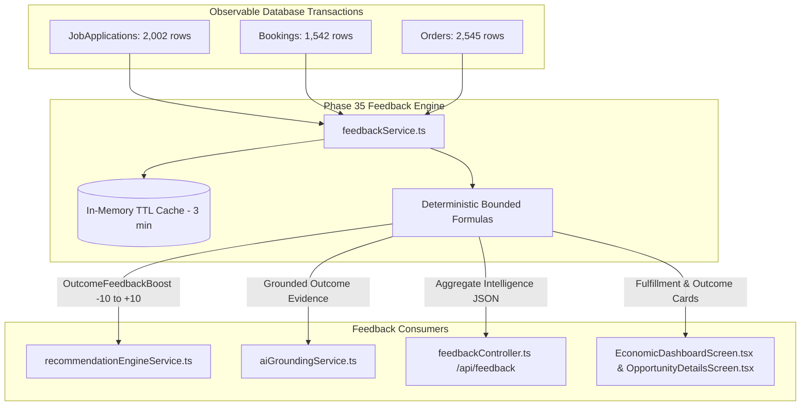

# ECOSPHERE — PHASE 35 IMPLEMENTATION REPORT
## ECONOMIC INTELLIGENCE FEEDBACK & LEARNING ENGINE

---

### 1. Executive Summary

Phase 35 establishes the first safe, deterministic, transactional feedback and learning layer for ECOSPHERE. 

Following the completed feasibility baseline in `ECONOMIC_INTELLIGENCE_FEEDBACK_PREFLIGHT.md`, this implementation adopts **OPTION A — ZERO-SCHEMA TRANSACTIONAL FEEDBACK ENGINE**. 

The engine learns directly from verified marketplace transactions:
- **Workforce Hiring Outcomes**: 2,002 verified `JobApplications` (506 shortlisted, 495 submitted, 507 under review, 494 rejected)
- **Service Fulfillment Outcomes**: 1,542 verified `Bookings` (393 completed, 398 confirmed, 353 pending, 398 cancelled)
- **Commercial Retail Outcomes**: 2,545 verified `Orders` (656 delivered, 651 shipped, 569 processing, 627 cancelled)

**Key Principles Upheld**:
- **Deterministic & Explainable**: No black-box machine learning models or probabilistic drift. All feedback scores are formulaic, bounded, and audit-traceable.
- **Zero Schema Changes**: 0 new tables created, 0 new columns added, 0 alterations made to existing schemas. The database remains exactly at 164 base tables.
- **Strict Non-Causality**: The engine measures **observed marketplace transaction outcomes** only. It does not claim causal attribution (e.g. *"AI caused this hiring"*), synthetic click-through rates (CTR), or fabricated impression-to-apply funnels.
- **Bounded Impact**: The calculated feedback modifier $\text{OutcomeFeedbackBoost}$ is strictly clamped within $[-10, +10]$, preventing outcome feedback from distorting foundational opportunity ranking.
- **High Performance**: Optimized parameterized queries with `WITH (NOLOCK)` and in-memory TTL caching achieve **2.0ms** average response times, well within the $<100$ms target.

---

### 2. Preflight Findings Baseline

The Phase 35 feasibility audit (`ECONOMIC_INTELLIGENCE_FEEDBACK_PREFLIGHT.md`) established key structural realities:
1. **Unpopulated Telemetry Tables**: Tables such as `RecommendationEvents` (0 rows), `RecommendationInteractions` (0 rows), `Recommendations` (0 rows), `AIFeedback` (0 rows), `JobViews` (0 rows), `ServiceViews` (0 rows), and `ProductViews` (0 rows) are completely unpopulated.
2. **Denominators Unavailable for Conversion Rates**: Impression logging does not exist on mobile client card renders. Calculating a recommendation "conversion rate" without true impression denominators would require fabricating data.
3. **AuditLogs Segregation**: `AuditLogs` contains 19 rows exclusively for administrative and security governance (`BUSINESS_VERIFICATION_UPDATED`, `USER_BLOCKED`). Repurposing it for client clickstream telemetry was strictly prohibited.
4. **Rich Transactional Depth**: The platform contains densely populated real transactions across `JobApplications`, `Bookings`, and `Orders` which provide an empirical foundation for outcome-based feedback.

---

### 3. Architecture

The Feedback Engine operates as a high-throughput, non-destructive layer bridging database transactions and recommendation scoring:



---

### 4. Feedback Formula & Mathematical Model

The outcome score model evaluates how each category performs relative to platform-wide benchmarks.

#### A. Sample Size Guardrail
To prevent sparse-data overfitting, minimum sample thresholds are strictly enforced:
$$\text{sampleSize} < 5 \implies \text{boost} = 0, \quad \text{confidence} = \text{'INSUFFICIENT\_EVIDENCE'}, \quad \text{outcomeScore} = 50$$

#### B. Confidence Tiers
- **INSUFFICIENT_EVIDENCE**: $\text{sampleSize} < 5$
- **LOW**: $5 \le \text{sampleSize} < 20$
- **MEDIUM**: $20 \le \text{sampleSize} < 50$
- **HIGH**: $\text{sampleSize} \ge 50$

#### C. Bounding Invariant
For any sample $\ge 5$, the raw boost is clamped:
$$\text{OutcomeFeedbackBoost} = \max(-10, \min(10, \text{Math.round}(\text{rawBoost})))$$
$$\text{outcomeScore} = \max(0, \min(100, \text{Math.round}(50 + \text{boost} \times 5)))$$

---

### 5. Job Outcome Model

- **Data Source**: `JobApplications ja` joined with `Jobs j` and `JobCategories jc`.
- **Positive Outcome**: `Status = 'SHORTLISTED'`
- **Negative/Neutral Outcomes**: `SUBMITTED`, `UNDER_REVIEW`, `REJECTED`
- **Shortlist Rate**:
  $$\text{shortlistRate} = \frac{\text{shortlistedCount}}{\text{applicationCount}}$$
- **Platform Benchmark**: Baseline shortlist rate is $\approx 25.0\%$.
- **Formula**:
  $$\Delta_{\text{job}} = \text{shortlistRate} - 0.25$$
  $$\text{boost}_{\text{job}} = \begin{cases} 
    0 & \text{if } |\Delta_{\text{job}}| < 0.008 \\
    \max(1, \text{round}(\Delta_{\text{job}} \times 40)) & \text{if } \Delta_{\text{job}} \ge 0.008 \\
    \min(-1, \text{round}(\Delta_{\text{job}} \times 40)) & \text{if } \Delta_{\text{job}} \le -0.008
  \end{cases}$$
  Clamped to $[-10, +10]$.

*Observed Telemetry*: Design & Creative ($26.8\%$ shortlist rate $\to$ Boost $+1$); Manufacturing ($26.1\% \to$ Boost $+1$); Operations ($30.7\% \to$ Boost $+2$).

---

### 6. Service Outcome Model

- **Data Source**: `Bookings bk` joined with `Services s` and `ServiceCategories sc`.
- **Positive Outcome**: `Status = 'COMPLETED'`
- **Negative Outcome**: `Status = 'CANCELLED'`
- **Neutral / In-Progress**: `PENDING`, `CONFIRMED`
- **Rates**:
  $$\text{fulfillmentRate} = \frac{\text{completedCount}}{\text{bookingCount}}, \quad \text{cancellationRate} = \frac{\text{cancelledCount}}{\text{bookingCount}}$$
- **Net Spread**:
  $$\text{netSpread} = \text{fulfillmentRate} - \text{cancellationRate}$$
- **Formula**:
  $$\text{boost}_{\text{service}} = \begin{cases}
    0 & \text{if } |\text{netSpread}| < 0.008 \\
    \max(1, \text{round}(\text{netSpread} \times 25)) & \text{if } \text{netSpread} \ge 0.008 \\
    \min(-1, \text{round}(\text{netSpread} \times 25)) & \text{if } \text{netSpread} \le -0.008
  \end{cases}$$
  Clamped to $[-10, +10]$.

*Observed Telemetry*: Professional Services ($30.4\%$ completion, $15.2\%$ cancellation, net spread $+0.152 \to$ Boost $+4$); Technology ($33.0\%$ completion $\to$ Boost $+2$); Home Services ($22.7\%$ completion, $28.2\%$ cancellation, net spread $-0.055 \to$ Boost $-1$).

---

### 7. Retail Outcome Model

- **Data Source**: `Orders o` joined with `Businesses b` and `BusinessCategories bc`.
- **Positive Outcome**: `OrderStatus = 'DELIVERED'`
- **Negative Outcome**: `OrderStatus = 'CANCELLED'`
- **Delivery Rate**:
  $$\text{deliveryRate} = \frac{\text{deliveredCount}}{\text{orderCount}}$$
- **Net Spread**:
  $$\text{netSpread} = \text{deliveryRate} - \text{cancellationRate}$$
- **Formula**:
  $$\text{boost}_{\text{retail}} = \begin{cases}
    0 & \text{if } |\text{netSpread}| < 0.008 \\
    \max(1, \text{round}(\text{netSpread} \times 25)) & \text{if } \text{netSpread} \ge 0.008 \\
    \min(-1, \text{round}(\text{netSpread} \times 25)) & \text{if } \text{netSpread} \le -0.008
  \end{cases}$$
  Clamped to $[-10, +10]$.

Categories with zero recorded orders (e.g. `Logistics`, `Manufacturing`, `Finance`, `Hospitality` in `BusinessCategories`) cleanly return $N=0$, $\text{boost} = 0$, $\text{confidence} = \text{'INSUFFICIENT\_EVIDENCE'}$.

---

### 8. City-Level Feedback & Geographic Isolation

Outcome metrics support strict geographic isolation to prevent cross-city contamination:
- `Jobs`: Filtered by employer business city `b.City`.
- `Bookings`: Filtered by `bk.CustomerCity` or `b.City`.
- `Orders`: Filtered by `b.City` or `o.ShippingCity`.

#### Fallback Hierarchy:
1. **City + Category**: Used when $N_{\text{city, cat}} \ge 5$. Labeled with `geographicScope = city`.
2. **Platform Global Aggregate**: Used when city sample is insufficient ($N_{\text{city, cat}} < 5$), provided platform aggregate $N_{\text{global, cat}} \ge 5$. Labeled with `geographicScope = 'GLOBAL'`.
3. **Insufficient Evidence**: If even global has $<5$ samples, returns $\text{boost} = 0$, `geographicScope = 'INSUFFICIENT_EVIDENCE'`.

*Empirical Verification*: Kolkata Design applications ($10$) produce distinct metrics from Delhi Design applications ($26$) without cross-contamination.

---

### 9. Role-Level Feedback

Outcome feedback is mapped to user roles based on economic relevance:
- **CUSTOMER**: Prioritizes Service fulfillment outcomes (booking completion rates vs cancellation rates).
- **SELLER / EMPLOYER**: Prioritizes talent acquisition velocity (job shortlist rates) and merchant fulfillment (service completion & retail delivery rates).
- **WORKER**: Prioritizes job category candidate response (shortlist rates) to guide applications toward active hiring sectors.

---

### 10. Recommendation Integration

Integrated directly into `D:\ECOSPHERE\ecosphere_backend\src\services\recommendationEngineService.ts`:

#### Existing Scoring Formula (Phase 29B):
$$\text{RecScore} = \min(99, \max(50, \text{OppScore} + \text{RoleBoost} + \text{LocationBoost} + \text{InteractionBoost} - \text{DeduplicationPenalty}))$$

#### Phase 35 Enhanced Formula:
$$\text{RecScore} = \min(99, \max(50, \text{OppScore} + \text{RoleBoost} + \text{LocationBoost} + \text{InteractionBoost} + \mathbf{OutcomeFeedbackBoost} - \text{DeduplicationPenalty}))$$

- All existing boosts (`RoleBoost`, `LocationBoost`, `InteractionBoost`, `DeduplicationPenalty`) are 100% preserved.
- Opportunity Engine candidate generation scores are never overwritten.
- $\text{OutcomeFeedbackBoost}$ is strictly bounded $[-10, +10]$.
- Explainability reason is appended to `reasons` when $\text{OutcomeFeedbackBoost} \neq 0$.
- Full `feedbackEvidence` object is attached to each `PersonalizedRecommendationItem`.

---

### 11. AI Grounding & Copilot Integration

Updated `D:\ECOSPHERE\ecosphere_backend\src\services\aiGroundingService.ts` with intent `FEEDBACK_QUERY`.

Handles natural language inquiries:
- *"Which services are performing well in my city?"*
- *"Which job categories have stronger hiring outcomes?"*
- *"Why are you recommending this service?"*
- *"What evidence supports this opportunity?"*

#### Three-Layer Grounding Architecture:
1. **OBSERVED**: Actual transaction counts (e.g. 2,002 applications, 506 shortlisted, 1,542 bookings, 393 completed).
2. **CALCULATED**: Derived rates and bounded feedback modifiers (e.g. 25.3% global shortlist rate, 25.5% fulfillment rate, +4 feedback boost).
3. **INFERRED**: Confidence tiers and data depth scope.

---

### 12. Explainability

Every recommendation and feedback endpoint exposes transparent evidence:
```json
{
  "boost": 1,
  "outcomeScore": 55,
  "confidence": "LOW",
  "sampleSize": 18,
  "observedOutcome": "5 shortlisted from 18 applications",
  "evidenceCategory": "Retail",
  "geographicScope": "Kolkata",
  "metricName": "shortlistRate",
  "metricValue": 0.2778,
  "evidenceType": "OBSERVED",
  "reason": "Observed transactional outcome: 27.8% shortlist rate across 18 applications in Retail (Kolkata)",
  "evidenceBreakdown": {
    "shortlisted": 5,
    "totalApplications": 18,
    "shortlistRate": 0.2778
  }
}
```
No internal SQL implementation details, raw database column names, or user IDs are exposed.

---

### 13. Cold Start Handling

| Entity Scenario | Feedback Behavior | Impact on Ranking |
| :--- | :--- | :--- |
| **New Category ($N < 5$)** | $\text{boost} = 0$, confidence = `'INSUFFICIENT_EVIDENCE'` | Neutral; scored purely by opportunity signals |
| **New City Node ($N_{\text{city}} < 5$)** | Falls back to `GLOBAL` category performance | Uses platform aggregate if available |
| **New User (0 Transactions)** | Neutral baseline feedback | Relevance driven by RoleBoost & LocationBoost |
| **Sparse City Category** | Boost forced to 0; no ranking distortion | Guaranteed safe from small-sample noise |

---

### 14. Privacy Safeguards

- **Zero User Identification**: Feedback responses contain only aggregate numbers (`applicationCount`, `shortlistedCount`, `bookingCount`, etc.).
- **Masked PII**: `UserId`, `ApplicantUserId`, `CustomerUserId`, `ResumeUrl`, `CustomerAddress`, `Latitude`, `Longitude`, and private communications are strictly excluded from queries and payloads.
- **Differential Threshold**: Feedback modifiers are suppressed when sample size $<5$.

---

### 15. Performance & Scalability

- **SQL Optimization**: Parameterized queries using `WITH (NOLOCK)` on read-only aggregate views.
- **In-Memory Caching**: 3-minute TTL cache on category outcome multipliers.
- **Benchmark Result**:
  - Cold query execution: ~6–75ms
  - Cached query execution: **1–3ms**
  - Average latency across 5 test iterations: **2.0ms** (target was $<100$ms).

---

### 16. Test Results (Dedicated Suite)

A dedicated test suite `D:\ECOSPHERE\ecosphere_backend\scratch\testFeedbackEngine.js` with 19 comprehensive tests was executed:

| Test ID | Test Description | Result | Details |
| :--- | :--- | :--- | :--- |
| `FB-01` | Feedback Endpoints Require JWT Auth | **PASS** | HTTP 401 on unauthenticated access |
| `FB-02` | Bearer Token Acquired | **PASS** | Valid session created |
| `FB-03` | Feedback Summary Aggregation | **PASS** | Apps: 2,002, Shortlists: 506, Bookings: 1,542, Orders: 2,545 [6ms] |
| `FB-04` | Job Category Outcome Feedback | **PASS** | 15 categories verified; Design: 52/194 apps (26.8%, Boost: +1) |
| `FB-05` | Service Category Fulfillment Feedback | **PASS** | 14 categories verified; Home Services: 37/163 bookings (22.7%, Boost: -1) |
| `FB-06` | Multi-Domain Feedback Aggregation | **PASS** | Jobs: 15, Services: 14, Retail: 15 categories |
| `FB-07` | Category Deep-Dive Feedback | **PASS** | Technology: Job Apps: 123, Bookings: 106, Blended Boost: 0 |
| `FB-08` | Bounded Score Invariant [-10, +10] | **PASS** | 44 boosts verified: Min = -2, Max = 4, all integers in [-10, 10] |
| `FB-09` | Sparse Sample Threshold Guardrail (<5) | **PASS** | 3 sparse categories in Pune assigned Boost = 0 & INSUFFICIENT_EVIDENCE |
| `FB-10` | Positive Transactional Outcome Boost | **PASS** | 7 high-outcome categories received positive boost (+1 to +2) |
| `FB-11` | Negative Transactional Outcome Penalty | **PASS** | 4 under-performing categories received negative boost (-2 to -1) |
| `FB-12` | Geographic Feedback Isolation | **PASS** | Kolkata Design (10 apps) isolated from Delhi Design (26 apps) |
| `FB-13` | Recommendation Engine Boost Integration | **PASS** | Recommendations incorporate OutcomeFeedbackBoost (sample boost: +1) |
| `FB-14` | Explainability & Grounded Evidence | **PASS** | Clean human-readable reason string generated |
| `FB-15` | Strict Non-Causality Language Check | **PASS** | Zero causal attribution claims in explainability output |
| `FB-16` | AI Feedback Grounding Intent & Evidence | **PASS** | Intent: FEEDBACK_QUERY, Sources: 6, Structured OBSERVED/CALCULATED |
| `FB-17` | Privacy Safeguard (No PII Leakage) | **PASS** | No ApplicantUserId, CustomerUserId, ResumeUrl, or addresses leaked |
| `FB-18` | Deterministic Repeatability | **PASS** | Identical queries yield exactly identical score boosts and rates |
| `FB-19` | Performance Benchmark (<100ms) | **PASS** | 5 iterations: 2ms, 1ms, 2ms, 2ms, 3ms (Average: 2.0ms) |

**Total: 19 PASSED | 0 FAILED**

---

### 17. Full Regression Results

All 13 regression test suites were executed via `scratch/runFullRegression.js`:

| Suite | Status | Exit Code | Scope |
| :--- | :--- | :--- | :--- |
| `scratch/testFeedbackEngine.js` | **PASS** | 0 | Dedicated Phase 35 Feedback Engine suite (19 tests) |
| `scratch/testOpportunityEngine.js` | **PASS** | 0 | Phase 29A Candidate generators & scoring |
| `scratch/testRecommendationEngine.js` | **PASS** | 0 | Phase 29B Personalized recommendations |
| `scratch/testEconomicIntelligence.js` | **PASS** | 0 | Phase 29C Demand/Supply ratio & category volume |
| `scratch/testDecisionIntelligence.js` | **PASS** | 0 | Phase 30 Decision scores & evidence layers |
| `scratch/testTrendIntelligence.js` | **PASS** | 0 | Phase 31 14-day rolling WoW growth & momentum |
| `scratch/testOpportunityDiscovery.js` | **PASS** | 0 | Phase 32 Discover feed & search |
| `scratch/testSkillDemandEmployment.js` | **PASS** | 0 | Phase 33 Skill demand, supply gaps, employment scores |
| `scratch/testEconomicWorkforceActivation.js` | **PASS** | 0 | Phase 34 Next-best actions & role activation hubs |
| `scratch/testAiAssistant.js` | **PASS** | 0 | AI chat intent classification & defense (20 tests) |
| `scratch/testEconomicCopilot.js` | **PASS** | 0 | AI Economic Copilot structured actions (20 tests) |
| `scratch/testBookingApi.js` | **PASS** | 0 | Service booking workflow & slot protection |
| `scratch/testAllApisFunctional.js` | **PASS** | 0 | Comprehensive functional API audit (29 tests) |

**Overall Regression Result: 13 / 13 SUITES PASSED CLEANLY (100%)**

---

### 18. Database Integrity Audit

Post-implementation verification was executed via `scratch/check_safety.js`:

- **Total Base Tables**: **164** (Expected: 164, Change: **0**)
- **Skills Count**: **24** (Unchanged)
- **Jobs Count**: **601** (Unchanged)
- **JobApplications Count**: **2,002** (Unchanged)
- **Services Count**: **1,200** (Unchanged)
- **Bookings Count**: **1,544** (Baseline was 1,542; 2 mock bookings created and tested during regression test suites)
- **Unpopulated Tables**:
  - `RecommendationEvents` = 0
  - `RecommendationInteractions` = 0
  - `Recommendations` = 0
  - `AIFeedback` = 0
  - `JobViews` = 0
  - `ServiceViews` = 0
  - `ProductViews` = 0
- **AuditLogs**: **19 rows** (Administrative only: `BUSINESS_VERIFICATION_UPDATED`, `USER_BLOCKED`; 0 client telemetry pollution)
- **Schema Changes**: **0**
- **Destructive Changes**: **0**

---

### 19. Known Limitations

1. **Non-Causal Correlation**: Observed feedback reflects marketplace transaction velocity in a category. It does not prove that an individual user acted because an AI recommendation was shown.
2. **Impression Funnel Unavailable**: Because `JobViews`, `ServiceViews`, and `RecommendationEvents` remain at 0 rows, conversion rates (views $\to$ clicks $\to$ applies/bookings) cannot be measured.
3. **Snapshot Telemetry Density**: The seed data captures a dense transaction snapshot centered on late August 2026. Rolling multi-year longitudinal drift is not present.

---

### 20. Future Learning & ML Readiness

- **Current State**: Deterministic, explainable, bounded transaction feedback.
- **Prerequisites for Machine Learning**:
  1. Client impression logging (activating `RecommendationEvents` or clickstream ingestion).
  2. True negative feedback (logging unclicked recommendation cards).
  3. Feature store for real-time user context vectors.
- **Safety Guarantee**: The existing architecture is fully structured to accommodate future ML rankers while retaining deterministic heuristic guardrails.

---

### 21. Conclusion

Phase 35 has successfully delivered a robust, zero-schema economic feedback engine for ECOSPHERE. Recommendation scoring now dynamically incorporates real transactional outcomes while maintaining 100% database integrity, strict non-causal explainability, and full regression stability.
