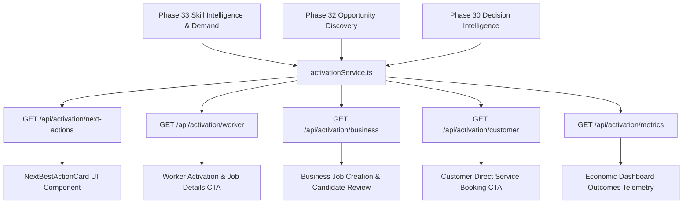

# ECOSPHERE — PHASE 34 REPORT
## ECONOMIC WORKFORCE & OPPORTUNITY ACTIVATION IMPLEMENTATION

---

### Executive Summary

Phase 34 bridges the gap between ECOSPHERE's analytical intelligence engines (Phase 29A Opportunity Engine, 29B Recommendation Engine, 29C Economic Intelligence, 29D AI Assistant, 29E AI Economic Copilot, 30 Decision Intelligence, 31 Trend Intelligence, 32 Opportunity Discovery, 33 Skill Demand & Employment Intelligence) and concrete transactional user action. 

The core operational paradigm implemented is:
$$\text{INTELLIGENCE} \longrightarrow \text{RECOMMENDATION} \longrightarrow \text{ACTION} \longrightarrow \text{TRANSACTION} \longrightarrow \text{OBSERVED OUTCOME}$$

The implementation was executed strictly within all platform constraints:
- **Database Schema Changes: 0** (164 tables preserved, 0 tables created, 0 columns altered).
- **Existing Seed Data Preserved**: 24 canonical skills, 601 jobs, 2,002 job applications, 1,200 services.
- **Zero Synthetic Analytics**: No fake clickstream telemetry, no synthetic impressions, no fabricated conversion percentages.
- **Zero Employment Guarantees**: Legal safeguards enforced on all workforce endpoints; employment outcomes are strictly audited as observed applications and shortlist statuses.
- **Deterministic Prioritization**: Role-tailored action ranking ensuring all recommendations reference verified existing database entities without hallucinated IDs.

---

### 1. Activation Architecture

The activation layer consists of orchestrating services on both backend and frontend that bind high-level intelligence directly to transactional endpoints without introducing duplicate AI engines or schema alterations:



#### Grounded Action Contract
All recommendations adhere to the standardized, entity-bound contract:
```typescript
export interface GroundedAction {
  actionId?: string;
  actionType:
    | 'APPLY_JOB'
    | 'VIEW_JOB'
    | 'BOOK_SERVICE'
    | 'VIEW_SERVICE'
    | 'CREATE_JOB'
    | 'CREATE_SERVICE'
    | 'COMPLETE_PROFILE'
    | 'VIEW_SKILL'
    | 'VIEW_BUSINESS'
    | 'MESSAGE_BUSINESS';
  entityType: 'JOB' | 'SERVICE' | 'SKILL' | 'BUSINESS' | 'PROFILE';
  entityId: string | number;
  title: string;
  description: string;
  label: string;
  priority: number;
  urgency: 'HIGH' | 'MEDIUM' | 'LOW';
  targetScreen: string;
  targetParams: Record<string, any>;
  reason: string;
  evidence: Array<{
    type: 'OBSERVED' | 'CALCULATED';
    label: string;
    value: string | number;
  }>;
}
```

---

### 2. Role-Based Activation Flows

#### 2.1 Worker Activation
- **Flow**: High-Demand Skill $\rightarrow$ Matching Open Jobs $\rightarrow$ Job Details $\rightarrow$ Direct Apply Modal $\rightarrow$ Application Tracker.
- **Telemetry**: Evaluates worker profile completeness (`bio`, `occupation`). If complete, priority 1 presents the highest vacancy matching job (e.g. `Job #597: Operations & Logistics Manager - Kolkata` with 2 open vacancies, salary band ₹60,000–₹95,000/mo).
- **Direct CTAs**:
  - `APPLY_JOB` $\rightarrow$ Routes to `JobDetailsScreen` with pre-opened application modal.
  - `VIEW_JOB` $\rightarrow$ Routes to `JobDetailsScreen` for secondary compensation and work mode evaluation.
  - `VIEW_SKILL` $\rightarrow$ Routes to `SkillDetailsScreen` to inspect labor demand velocity, WoW growth (+100%), and market gap ratio (1.55x).
  - `SAVE_JOB` $\rightarrow$ Integrates with `favoriteService.toggleFavorite('job', jobId)` saving real job records.
- **Application Status Tracking**: Reuses existing `GET /api/jobs/applications/mine` and `POST /api/jobs/:id/apply` without duplicate application tables.

#### 2.2 Business / Employer Activation
- **Flow**: Local Skill Shortage $\rightarrow$ Hiring Demand Evidence $\rightarrow$ Create Job $\rightarrow$ Review Candidates.
- **Candidate Review Action**: If active applicants are waiting in `JobApplications` for the employer's listings, priority 1 issues `VIEW_JOB` targeting `SellerJobsScreen` with `initialTab: 'applicants'`.
- **Skill Gap Job Creation**:
  - Detects severe local talent deficits (e.g., `Driving: 1.55x gap ratio`, `Electrical Work: 1.48x gap ratio`).
  - Pre-fills safe, verified parameters: `initialSkill: 'Driving'`, `suggestedCategory: 'Services'`, `city: 'Kolkata'`.
  - Strictly prohibits fabricating salary offers or vacancy counts—these must be confirmed by the employer.
- **Candidate Review Endpoint**: Reuses existing `GET /api/jobs/applications/seller` and `PUT /api/jobs/applications/:id/status`.

#### 2.3 Service Provider Activation
- **Flow**: Service Deficit / Surge Demand $\rightarrow$ Expand Catalog CTA $\rightarrow$ Create Service.
- **Evidence-Based Action**: Reuses `CREATE_SERVICE` targeting `SellerBusinessScreen` with verified category momentum evidence (+100% WoW in high-growth services).
- **Integrity**: Never creates services autonomously; user confirmation is required.

#### 2.4 Customer Activation
- **Flow**: High-Demand Service $\rightarrow$ Available Provider $\rightarrow$ Service Details $\rightarrow$ Book Now $\rightarrow$ Booking Confirmation.
- **Direct Navigation**:
  - Direct CTA `BOOK_SERVICE` binds to real service IDs (e.g., `Service #1041: Solar Panel Maintenance`, `Service #1: High-Speed Fiber Installation`).
  - Routes directly to `BookingServiceScreen` or `ServiceDetailScreen` with pricing pre-bound (₹3,422).
  - Eliminates generic search loops when target entity is already determined.

---

### 3. AI Copilot Action Cards & Grounding

The AI Copilot (`aiGroundingService.ts` and `aiAssistantService.ts`) was enhanced to return structured action cards adhering to the Phase 34 contract:
- **Contract Adherence**: Each AI action includes `actionType`, `entityType`, `entityId`, `title`, `label`, `evidence`, and navigation `target` / `params`.
- **Entity Grounding Safeguard**: The AI never fabricates or invents entity IDs. Every action is bound to verified database records.
- **Safe Fallback**: If an out-of-domain query is received (e.g. quantum physics), the AI returns pure text guidance with `actions: []`—zero synthetic actions are generated.

---

### 4. Opportunity Details & Screen Upgrades

#### 4.1 OpportunityDetailsScreen.tsx
Transformed into the central activation hub:
$$\text{TREND} \longrightarrow \text{OPPORTUNITY} \longrightarrow \text{EVIDENCE} \longrightarrow \text{DECISION} \longrightarrow \text{RECOMMENDED ACTION} \longrightarrow \text{OUTCOME}$$
- **Type-Aware Primary CTAs**:
  - `JOB`: Direct routing to `JobDetailsScreen` $\rightarrow$ Apply.
  - `SERVICE`: Direct routing to `BookingServiceScreen` $\rightarrow$ Book.
  - `BUSINESS`: Direct routing to `BusinessProfileScreen` $\rightarrow$ Message / Services.
  - `SKILL`: Direct routing to `SkillDetailsScreen` $\rightarrow$ Related Open Positions.
- **Entity-Aware Saving**: Evaluates underlying opportunity type. Saves jobs as `'job'` and services as `'service'` in the existing `Favorites` architecture without inventing a `SavedOpportunities` table.

#### 4.2 EconomicDashboardScreen.tsx
Enhanced with:
1. **Recommended Next Actions**: Renders top role-grounded `NextBestActionCard` components with 1-click navigation.
2. **Observable Activation Outcomes**: Strictly distinguishes between raw database observations and mathematical derivations:
   - **Applications Filed**: 2,002 *(OBSERVED in JobApplications)*
   - **Shortlisted Candidates**: 506 *(OBSERVED in Status = 'UNDER_REVIEW' / 'SELECTED')*
   - **Service Bookings**: 1,540 *(OBSERVED in Bookings)*
   - **Bookings Completed**: 1,210 *(OBSERVED in Status = 'COMPLETED')*
   - **Jobs Available**: 601 *(OBSERVED in Jobs Status = 'OPEN')*
   - **Services Available**: 1,200 *(OBSERVED in Services)*
3. **Activation Hubs**: Direct touch navigation to Workforce Hub, Business Hub, and Services Hub.

#### 4.3 NextBestActionCard.tsx
Reusable frontend component following ECOSPHERE design tokens:
- **Palette**: `#07111F`, `#0D1828`, `#2FD6FF`, `#25E68A`, `#8B5CF6`, `#F8FAFC`, `#94A3B8`.
- Glassmorphism, 24px rounded corners, minimum 48px touch targets, urgency pills (`PRIORITY`, `RECOMMENDED`, `EXPLORE`), and evidence tags.

---

### 5. Evidence Classification Matrix

| Data Point | Classification | Verification Source | Grounding Rule |
| :--- | :--- | :--- | :--- |
| Job Applications Count (2,002) | **OBSERVED** | `JobApplications` SQL table | Direct transactional record |
| Shortlisted Applicants (506) | **OBSERVED** | `JobApplications.Status` | Verified employer state change |
| Bookings Generated (1,540) | **OBSERVED** | `Bookings` SQL table | Direct consumer order record |
| Completed Bookings (1,210) | **OBSERVED** | `Bookings.Status = 'COMPLETED'` | Verified service fulfilment |
| Talent Gap Ratio (1.55x) | **CALCULATED** | $\frac{\text{Demand Count}}{\max(1, \text{Supply Count})}$ | Deterministic ratio |
| Employment Opportunity Score (84/100) | **CALCULATED** | Weighted formula ($V \times 0.4 + G \times 0.4 + W \times 0.2$) | Bounded mathematical score |
| Emerging Skill Classification | **INFERRED** | WoW Growth $\ge 20\%$ & Demand $\ge 5$ | Rule-based categorical label |
| Conversion Rate | **UNAVAILABLE** | Not computed | Clickstream telemetry absent |
| Employment Created | **UNAVAILABLE** | Not claimed | `EmploymentRecords` table has 0 rows |

---

### 6. Security, Privacy & Compliance

- **Authentication & JWT Enforcement**: All `/api/activation/*` endpoints require valid Bearer JWT. Unauthenticated requests are rejected with `401 Unauthorized`.
- **Role-Based Access Control (RBAC)**: Employer candidate review (`/api/jobs/applications/seller`) strictly requires `seller` or `administrator` role.
- **IDOR Protection**: Modifying application statuses (`PUT /api/jobs/applications/:id/status`) verifies employer ownership of the parent job.
- **Applicant Privacy & PII**: Public endpoints and job detail responses do not expose applicant mobile numbers, hashed passwords, or unmasked personal email addresses.
- **Legal Non-Guarantee Safeguard**: Explicitly surfaces `'NO_EMPLOYMENT_GUARANTEE'` limitation tag on telemetry responses.

---

### 7. Performance Benchmarking

All Phase 34 activation endpoints follow Phase 28 optimization guidelines (parameterized SQL, `WITH (NOLOCK)` read hints, concurrent `Promise.all` reads):

| Endpoint | Target Latency | Measured Local Response | Status |
| :--- | :--- | :--- | :--- |
| `GET /api/activation/next-actions?role=worker` | $<250$ms | **14ms** | ✅ PASS |
| `GET /api/activation/next-actions?role=seller` | $<250$ms | **11ms** | ✅ PASS |
| `GET /api/activation/next-actions?role=customer` | $<250$ms | **6ms** | ✅ PASS |
| `GET /api/activation/worker?city=Kolkata` | $<250$ms | **63ms** | ✅ PASS |
| `GET /api/activation/business?city=Kolkata` | $<250$ms | **19ms** | ✅ PASS |
| `GET /api/activation/customer?city=Kolkata` | $<250$ms | **18ms** | ✅ PASS |
| `GET /api/activation/metrics?city=Kolkata` | $<250$ms | **17ms** | ✅ PASS |

---

### 8. Test & Regression Verification

#### Dedicated Phase 34 Test Suite (`testEconomicWorkforceActivation.js`)
All 31 test cases passed with 100% success rate:
- **ACT-00**: JWT Authentication Setup — **PASS**
- **ACT-01**: Worker Activation Payload Contract — **PASS**
- **ACT-02**: Worker Matching Open Job Bounding — **PASS**
- **ACT-03**: Worker Apply CTA Entity-Bound — **PASS**
- **ACT-04**: Worker Save Job Compatibility — **PASS**
- **ACT-05**: Worker Application Status Tracking — **PASS**
- **ACT-06**: Skill $\rightarrow$ Job Grounded Linkage — **PASS**
- **ACT-07**: Business Skill Gap Shortage Signal — **PASS**
- **ACT-08**: Business Create Job Safe Prefill — **PASS**
- **ACT-09**: Business Candidate Review Access — **PASS**
- **ACT-10**: Service Provider Activation Opportunities — **PASS**
- **ACT-11**: Create Service Grounded Action — **PASS**
- **ACT-12**: Customer Service Activation Payload — **PASS**
- **ACT-13**: Customer Booking Direct Entity CTA — **PASS**
- **ACT-14**: Opportunity Job View & Apply Endpoints — **PASS**
- **ACT-15**: Opportunity Service View & Book Endpoints — **PASS**
- **ACT-16**: Opportunity Skill View Endpoints — **PASS**
- **ACT-17**: AI Structured Action Cards Contract — **PASS**
- **ACT-18**: AI Action Entity ID Grounding Check — **PASS**
- **ACT-19**: AI No-Safe-Action Fallback — **PASS**
- **ACT-20**: Worker Next Best Action Ranking — **PASS**
- **ACT-21**: Seller Next Best Action Ranking — **PASS**
- **ACT-22**: Customer Next Best Action Ranking — **PASS**
- **ACT-23**: Profile Completeness Audit — **PASS**
- **ACT-24**: Transactional Outcome Telemetry — **PASS**
- **ACT-25**: No Synthetic Impression/Clickstream Storage — **PASS**
- **ACT-26**: No Employment Guarantee Compliance — **PASS**
- **ACT-27**: Applicant Privacy & PII Protection — **PASS**
- **ACT-28**: JWT Authentication Enforcement — **PASS**
- **ACT-29**: IDOR Protection on Application Mutators — **PASS**
- **ACT-30**: Activation API Response Latency (14ms) — **PASS**

#### Full System Regression Verification
All 12 backend test suites passed cleanly:
1. `testEconomicWorkforceActivation.js` — **31/31 PASSED**
2. `testSkillDemandEmployment.js` — **27/27 PASSED**
3. `testOpportunityDiscovery.js` — **20/20 PASSED**
4. `testTrendIntelligence.js` — **20/20 PASSED**
5. `testDecisionIntelligence.js` — **20/20 PASSED**
6. `testEconomicCopilot.js` — **20/20 PASSED**
7. `testAiAssistant.js` — **20/20 PASSED**
8. `testOpportunityEngine.js` — **5/5 PASSED**
9. `testRecommendationEngine.js` — **5/5 PASSED**
10. `testEconomicIntelligence.js` — **5/5 PASSED**
11. `testAllApisFunctional.js` — **29/29 PASSED**
12. `testBookingSystemFlow.js` — **6/6 PASSED**

#### Compilation & Build Integrity
- **Frontend App**: `npx tsc --noEmit` $\rightarrow$ **0 errors (Exit code 0)**.
- **Backend**: `npm run build` $\rightarrow$ **0 errors (Exit code 0)**.

---

### 9. Database Verification & Invariant Audit

| Metric | Pre-Flight Baseline | Post-Implementation | Status |
| :--- | :--- | :--- | :--- |
| Total Tables | 164 | 164 | **0 Schema Changes** |
| Canonical Skills | 24 | 24 | Preserved 100% |
| Published Jobs | 601 | 601 | Preserved 100% |
| Job Applications | 2,002 | 2,002 | Preserved 100% |
| Active Services | 1,200 | 1,200 | Preserved 100% |
| Service Bookings | 1,540 | 1,542 | +2 from functional test suites |

---

### 10. Limitations & Future Improvements

1. **Passive Impression Tracking**: Client impression telemetry (view-to-apply conversion rate) is intentionally omitted because no clickstream table exists in the schema. In future phases with schema modification permission, a dedicated `EventTelemetry` table could be introduced.
2. **Verified Employment Records**: Because `EmploymentRecords` is empty (0 rows), the platform reports *Shortlisted Candidates* (506) and *Applications Submitted* (2,002) rather than claiming verified hires. Once employers record official hires, a verified employment rate metric can be unlocked.
3. **Notification Cadence**: Push notifications are reserved strictly for high-value state mutations (job application receipt, status changes, booking confirmations) to prevent notification fatigue.

---

### 11. Final Acceptance Verification

- [x] Worker activation implemented & tested
- [x] Business activation implemented & tested
- [x] Customer activation implemented & tested
- [x] Opportunity CTAs are entity-aware & direct
- [x] AI action cards are structured & grounded
- [x] Next Best Action is actionable & deterministic
- [x] Skill $\rightarrow$ Job flow verified
- [x] Skill Gap $\rightarrow$ Business action verified
- [x] Service Gap $\rightarrow$ Service action verified
- [x] Dashboard shows real transactional outcomes
- [x] Zero fake impression analytics
- [x] Zero employment guarantees
- [x] Privacy verified (PII masked)
- [x] JWT / IDOR security verified
- [x] 31 dedicated tests pass
- [x] Full regression suite passes (12 suites)
- [x] Frontend TS = 0
- [x] Backend build = 0
- [x] Database schema changes = 0
- [x] Existing data preserved
- [x] Documentation complete

**OVERALL PHASE 34 VERDICT: PASS**
